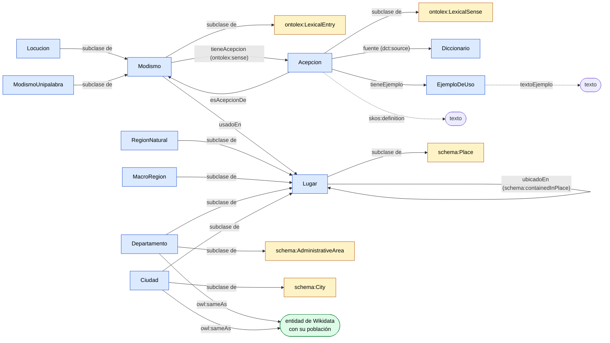
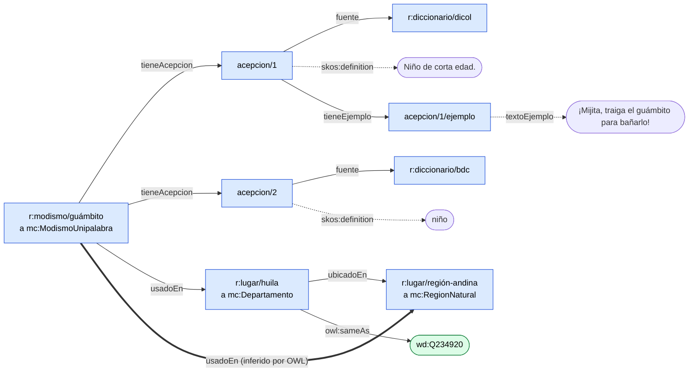

# Ontología de modismos colombianos

Proyecto que reemplaza el parcial 2 de Web Semántica. La idea es tomar los modismos del artículo de modismos colombianos, con sus significados y las regiones donde se usan, y volverlos un grafo de conocimiento con RDF, RDFS, OWL y SHACL. Después se consulta con SPARQL en Fuseki, se enlaza con Wikidata y se ve en una página web.

Los datos salen del repo `Modismos_EMNLP_2026`. Ese repo no se modifica, solo se lee. La ruta está en `configuracion.py`.

## Preguntas de competencia

Las escribimos antes de poblar el grafo. Sirven para saber qué tiene que poder responder la ontología y para revisar el modelo.

| # | Tipo | Pregunta |
|---|---|---|
| CQ1 | Navegación | ¿Qué modismos se usan en la Región Andina, contando los que vienen de sus departamentos y de Bogotá? |
| CQ2 | Recuperación | ¿Qué acepciones tiene cada modismo de la Costa Atlántica con más de un significado y de qué diccionario sale cada una? |
| CQ3 | Agregación | ¿Cuántos modismos tiene cada departamento y cuántos habitantes tiene según Wikidata? |

## Cómo está armada la ontología

Hay dos partes que se conectan por el modismo.

**Léxico.** Un `mc:Modismo` tiene una o varias `mc:Acepcion`, cada acepción tiene su definición, su diccionario de origen (DICOL o BDC) y a veces un `mc:EjemploDeUso`. Los modismos se dividen en `mc:Locucion` (varias palabras) y `mc:ModismoUnipalabra`.

**Geografía.** `mc:Lugar` se divide en `mc:RegionNatural`, `mc:MacroRegion`, `mc:Departamento` y `mc:Ciudad`. Los lugares se unen con `mc:ubicadoEn`. Por ejemplo Atlántico queda en la Costa Atlántica, que queda en la Región Caribe. Un modismo se une a un lugar con `mc:usadoEn`.

Así queda todo junto.



1. Azul son las clases nuestras, con prefijo `mc`.
2. Amarillo son las clases de OntoLex y schema.org que extendemos.
3. Verde es lo que sale de Wikidata. La población de la CQ3 se trae de ahí.
4. Las flechas con nombre de propiedad unen una clase con otra. Entre paréntesis va la propiedad externa que extiende.
5. Las flechas punteadas llegan a un texto. `skos:definition` es de SKOS y `textoEjemplo` es nuestra.

Este es un modismo de verdad, `guámbito`, tal como queda en `datos/instancias.ttl`.



La flecha gruesa no está en los datos. La pone owlrl con la cadena `usadoEn` y `ubicadoEn`. En los datos `guámbito` también se usa en Tolima, pero no se dibujó para que no se llene.

### Vocabularios que reusamos

No inventamos lo que ya existe. Nuestras clases y propiedades extienden otras sin redefinirlas.

| Término nuestro | Extiende a | Vocabulario |
|---|---|---|
| `mc:Modismo` | `ontolex:LexicalEntry` | OntoLex Lemon |
| `mc:Acepcion` y `mc:tieneAcepcion` | `ontolex:LexicalSense` y `ontolex:sense` | OntoLex Lemon |
| definición de una acepción | `skos:definition` | SKOS |
| `mc:fuente` | `dct:source` | Dublin Core |
| `mc:Lugar`, `mc:Departamento`, `mc:Ciudad` | `schema:Place`, `schema:AdministrativeArea`, `schema:City` | schema.org |
| `mc:ubicadoEn` | `schema:containedInPlace` | schema.org |

### Axiomas OWL

Cada axioma está porque es cierto en el dominio, no para llegar a un número.

| # | Tipo | Axioma | Por qué es cierto |
|---|---|---|---|
| 1 | Disyunción | `Locucion disjointWith ModismoUnipalabra` | Una expresión no puede tener una palabra y varias a la vez. |
| 2 | Inversa | `esAcepcionDe inverseOf tieneAcepcion` | Si un modismo tiene una acepción, la acepción es de ese modismo. |
| 3 | Transitiva | `ubicadoEn` es `TransitiveProperty` | Si Atlántico está en la Costa Atlántica y esta en la Región Caribe, Atlántico está en la Región Caribe. |
| 4 | Cadena de propiedades | `usadoEn o ubicadoEn` implica `usadoEn` | Si un modismo se usa en Nariño, también se usa en la Región Pacífica. |

## Datos

Todo se genera por código. Las IRI salen del texto de cada cosa, nunca de contadores, así que al volver a correr salen iguales. Por ejemplo `r:modismo/a-juro/acepcion/2` o `r:lugar/costa-atlántica`. Las IRI dejan tildes y ñ porque si no `caña` y `cana` quedaban como el mismo modismo. El vocabulario (`ontologia/modcol.ttl`, espacio `http://example.org/modcol/ontologia#`) y los datos (`datos/instancias.ttl`, espacio `http://example.org/modcol/recurso/`) van en archivos y espacios de nombres separados.

| Qué | Cuántos |
|---|---|
| Modismos | 5284 |
| Acepciones | 8129 |
| Modismos con región | 504 |
| Departamentos, macro regiones, regiones naturales y Bogotá | 32, 3, 6 y 1 |
| Triples de la ontología | 93 |
| Triples de datos | 59121 |
| Triples que agrega owlrl | 81157 |
| Enlaces a Wikidata | 33 |

Algunas decisiones sobre los datos.

1. Dos modismos se juntan con otro por el nombre (`chivo,` con `chivo` y `danza del Garabato` con `danza del garabato`). Por eso hay 5284 y no 5286.
2. `datos/muestra.jsonld` tiene dos modismos en JSON-LD para mostrar ese formato.

## Razonamiento

`scripts/04_razonar.py` corre owlrl sobre todo el grafo. Tarda unos quince segundos y no encuentra inconsistencias. Esto es lo que cambia.

| Consulta | Sin razonar | Con owlrl |
|---|---|---|
| modismos (`a mc:Modismo`) | 0 | 5284 |
| usados en la Región Andina | 0 | 320 |
| acepciones con `esAcepcionDe` | 0 | 8129 |
| lugares dentro de la Región Caribe | 1 | 8 |

En los datos ningún modismo dice que es `mc:Modismo`, solo `Locucion` o `ModismoUnipalabra`. El tipo `Modismo` lo pone la jerarquía de clases.

El script también prueba que el razonador encuentra errores. Mete un modismo que es locución y unipalabra a la vez y owlrl lo marca como inconsistente.

Los razonadores OWL de Jena no manejan `propertyChainAxiom`. Por eso en Fuseki el servicio OWL carga lo que infirió owlrl en `datos/inferido.ttl`, y Jena solo se usa para RDFS.

## SHACL

OWL infiere, SHACL revisa. `shapes/modcol-shapes.ttl` tiene formas para modismos, locuciones, modismos de una palabra, acepciones, ejemplos y departamentos. Usa `minCount`, `maxCount`, `datatype`, `class`, `pattern`, `minLength`, `in`, `or` y `node`.

`scripts/05_validar.py` valida con pyshacl. Los datos reales pasan. `datos/error_instancias.ttl` tiene tres errores puestos a propósito y SHACL encuentra los cuatro problemas que hay en ellos.

| Recurso | Problema |
|---|---|
| `modismo/berraco` | El modismo no tiene ninguna acepción. |
| `modismo/chévere` | Una locución debe tener más de una palabra. |
| `modismo/chévere/acepcion/1` | La acepción debe tener una sola definición. |
| `modismo/chévere/acepcion/1` | La fuente debe ser DICOL o BDC. |

## Fuseki y las preguntas de competencia

`docker-compose.yml` levanta Fuseki con tres servicios sobre los mismos archivos, igual que en el taller 3.

1. `modcol-base` tiene los datos tal cual.
2. `modcol-rdfs` usa el razonador RDFS de Jena.
3. `modcol-owl` tiene además lo que infirió owlrl.

`scripts/06_consultas.py` corre las consultas de `consultas/` en los tres y guarda lo del servicio OWL en `resultados/`. Este es el número de filas.

| Consulta | base | rdfs | owl |
|---|---|---|---|
| CQ1 | 0 | 0 | 581 |
| CQ2 | 289 | 289 | 298 |
| CQ3 | 32 | 32 | 32 |

CQ1 solo se puede responder con el razonamiento OWL porque usa la cadena de propiedades. CQ2 sale en los tres, pero sin razonar solo encuentra los modismos marcados directamente como Costa Atlántica y no los de sus departamentos.

Lo que dicen las respuestas.

1. CQ1. 320 modismos se usan en la Región Andina. Cundinamarca aporta 200 y Bogotá solo 5.
2. CQ2. Hay 97 modismos de la Costa Atlántica con más de un significado. En 79 de ellos un significado sale de DICOL y otro de BDC.
3. CQ3. Cundinamarca tiene más modismos (200), pero por habitante el primero es Boyacá.

## Wikidata

`scripts/03_wikidata.py` enlaza los 32 departamentos y Bogotá con Wikidata usando la misma regla del taller 5. Se cuentan tres señales.

1. El nombre coincide con la etiqueta o un alias en español.
2. En Wikidata es departamento de Colombia (Q215655) o distrito capital (Q395994).
3. El país es Colombia (Q739).

Con tres señales se pone `owl:sameAs`, con dos `skos:closeMatch` y con menos no se enlaza. Los 33 quedaron con `owl:sameAs`.

Para la CQ3 Fuseki no puede hacer `SERVICE` contra Wikidata porque le responden 403 por el User-Agent (lo vimos en la lectura 4). Por eso el cruce se hace desde Python. Primero se cuentan los modismos por departamento en Fuseki y luego se pide la población a Wikidata con `VALUES`. El resultado está en `resultados/cq3_wikidata.csv`.

## Página web

`scripts/09_exportar_web.py` saca con SPARQL lo que necesita la página y lo guarda en `web/public/datos.json`. La página está hecha con React y Vite en la carpeta `web/`. Tiene un mapa de Colombia con las regiones naturales, barras con los modismos de cada región, la lista de modismos de cada departamento, y un buscador con la ficha de cada modismo (acepciones, ejemplos y lugares).

### Por qué hay dos cifras en el mapa

El mapa se puede ver por región o por departamento, y las cifras no cuadran a propósito.

Muchos modismos del diccionario no dicen el departamento, solo la macro región. Por ejemplo dicen Costa Atlántica o Llanos Orientales. La ontología guarda exactamente eso, `usadoEn r:lugar/costa-atlántica`, y el razonador infiere hacia arriba. Con la cadena `usadoEn` y `ubicadoEn` ese modismo queda usado también en la Región Caribe. Pero nunca infiere hacia abajo. Que un modismo se use en la Costa Atlántica no quiere decir que se use en Cesar o en Sucre, y OWL no afirma lo que no sabe.

Por eso la vista por región da lo mismo que el artículo (Andina 320, Caribe 162, Pacífica 107 y Orinoquía 39) y la vista por departamento deja en cero a Cesar, Córdoba, Sucre, Meta, Casanare, Arauca y Vichada.

| Región | Total | Con departamento | Solo con macro región |
|---|---|---|---|
| Andina | 320 | 320 | 0 |
| Caribe | 162 | 9 | 153 |
| Pacífica | 107 | 104 | 3 |
| Orinoquía | 39 | 0 | 39 |

El mapa del artículo (`Geo_Analysis.ipynb`) hace otra cosa. Reparte cada macro región a todos sus departamentos con `REGION_AGGREGATES`, así que allá Cesar aparece con 149 modismos. Es una forma de dibujar, no un dato del diccionario. Al hacer clic en un departamento la página muestra las dos cosas, los modismos marcados en el departamento y los que solo dicen su macro región.

Los departamentos de la Amazonía y San Andrés salen en cero en las dos vistas porque el diccionario no trae modismos de allí.

La pestaña Grafo muestra el nodo de un modismo con sus relaciones. Esta parte no usa `datos.json`, le pregunta en vivo a Fuseki desde el navegador.

1. Se busca un modismo por su `rdfs:label` y se traen las tripletas que salen de él y hasta 25 que llegan.
2. Con nivel 2 se traen también las conexiones de cada vecino.
3. Al hacer clic en un nodo se agregan sus conexiones.
4. Con inferencia OWL se consulta `modcol-owl` y las relaciones que no están en `modcol-base` salen punteadas. Así se ve lo que agregó el razonador, por ejemplo `usadoEn` hasta la región.
5. Las listas de relaciones y tipos de nodo sirven para esconder lo que estorba.

La pestaña Consultas tiene las preguntas de competencia de la carpeta `consultas/`. Al elegir una se corre en Fuseki y el resultado sale en una tabla. Se puede escoger el servicio (`modcol-base`, `modcol-rdfs` o `modcol-owl`) para ver qué cambia con cada razonador, y la consulta se puede editar y volver a correr con Ctrl y Enter.

Cada pestaña queda en la dirección del navegador, por ejemplo `/grafo/achucutarse?nivel=2&owl=1` o `/consultas/cq2`. Así se puede recargar o mandar el enlace sin perder lo que se estaba viendo, y los botones de atrás y adelante funcionan.

Con `docker compose up -d --build` se compila la página dentro de Docker y queda en http://localhost:8000, no hace falta tener Node. Para cambiar la página con recarga en vivo se usa Node 22.

```
cd web
npm install
npm run dev
```

Eso la abre en http://localhost:5173 y sigue usando Fuseki en el puerto 3030.

## Cómo correr todo

Los datos ya están generados, así que basta con un comando.

```
docker compose up -d --build
```

Eso prende Fuseki con la ontología, las instancias y lo inferido ya cargados en http://localhost:3030 (usuario admin y clave admin) y la página en http://localhost:8000. Fuseki tarda uno o dos minutos en cargar los archivos.

Para generar todo otra vez desde el repo del artículo se corren los scripts en orden.

```
python -m venv .venv
.venv/bin/pip install -r requirements.txt
.venv/bin/python scripts/01_ontologia.py
.venv/bin/python scripts/02_instancias.py
.venv/bin/python scripts/03_wikidata.py
.venv/bin/python scripts/04_razonar.py
.venv/bin/python scripts/05_validar.py
docker compose up -d --force-recreate
.venv/bin/python scripts/06_consultas.py
.venv/bin/python scripts/09_exportar_web.py
```

Los scripts se corren desde esta carpeta.

## Qué se ve de cada tema del curso

| Tema | Dónde |
|---|---|
| RDF y formatos | `datos/instancias.ttl` en Turtle y `datos/muestra.jsonld` en JSON-LD |
| RDFS | jerarquías de clases y propiedades, dominios y rangos, servicio `modcol-rdfs` |
| OWL | 4 axiomas, owlrl, servicio `modcol-owl`, prueba de inconsistencia |
| SPARQL | 3 CQ con subconsulta, `GROUP BY`, `HAVING`, `OPTIONAL`, `FILTER` y caminos de propiedades |
| SHACL | `shapes/modcol-shapes.ttl` con pyshacl y datos con errores |
| Reuso de vocabularios | OntoLex, SKOS, Dublin Core y schema.org |
| Linked Data | `owl:sameAs` con Wikidata y cruce de datos con `VALUES` |
| Metodología | CQ escritas antes de poblar, IRI reproducibles, vocabulario y datos separados |
